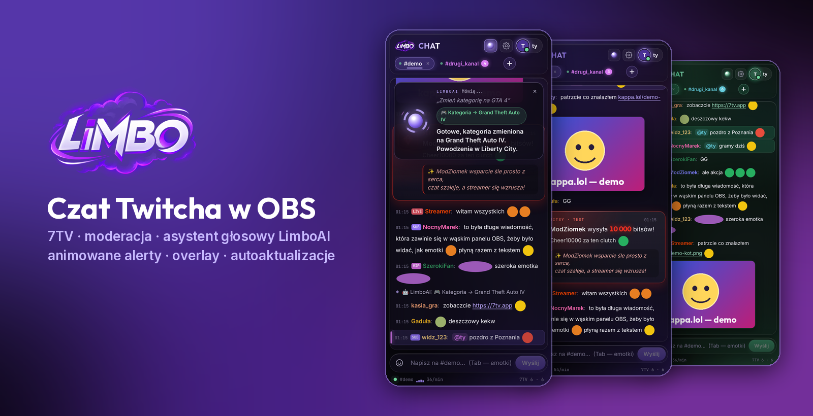
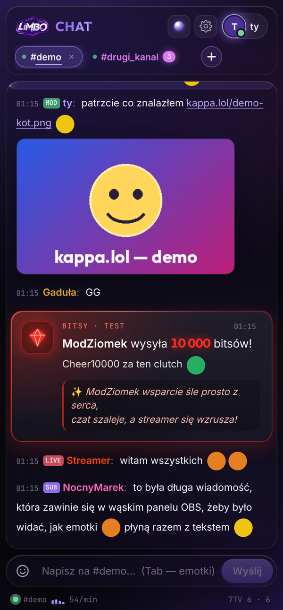
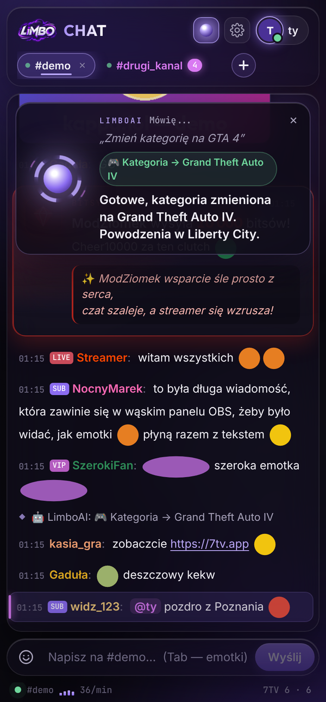
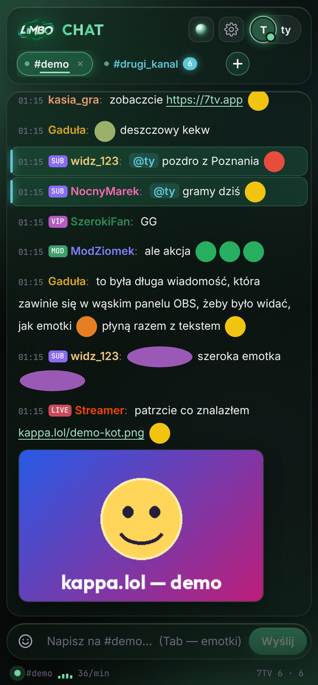
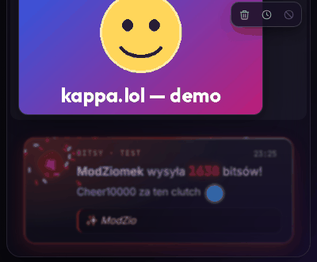
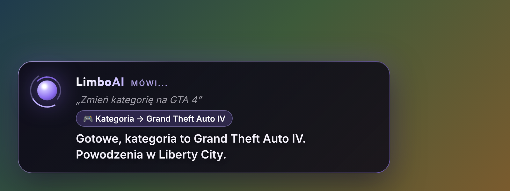
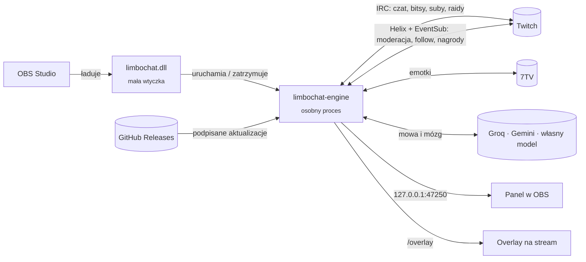
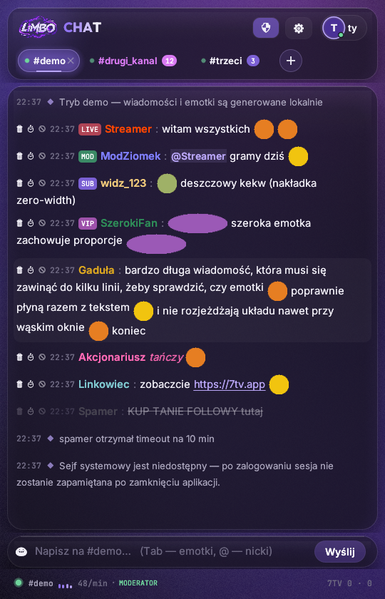

<div align="center">



# LiMBOCHAT

**Czat Twitcha prosto w OBS — z emotkami 7TV, moderacją jednym kliknięciem, asystentem głosowym LimboAI, animowanymi alertami i overlayem na stream.**

[](https://github.com/YoungKosmi/limbochat/releases/latest)
[](https://github.com/YoungKosmi/limbochat/releases)
[](#instalacja)
[](#instalacja)
[](#budowanie)
[](LICENSE)

[**⬇️ Pobierz**](https://github.com/YoungKosmi/limbochat/releases/latest) ·
[Funkcje](#funkcje) ·
[Instalacja](#instalacja) ·
[LimboAI](#limboai) ·
[Bezpieczeństwo](#bezpieczenstwo) ·
[Dokumentacja](docs/DOKUMENTACJA.md)

</div>

---

<a id="funkcje"></a>

## ✨ Funkcje

<table>
<tr>
<td width="50%" valign="top">

### 💬 Czat i moderacja
- Kilka kanałów naraz w zakładkach, liczniki nieprzeczytanych, podświetlone **@wzmianki**
- **Emotki 7TV** (globalne, kanałowe, animowane, zero-width) i odznaki Twitcha w linii z tekstem
- Pisanie z emotkami: picker albo **Tab** jak w Chatterino
- Moderacja jednym kliknięciem — usuń, timeout, ban — i menu pod nickiem
- **Obrazki z kappa.lol** od razu na czacie, bez otwierania strony

</td>
<td width="50%" valign="top">

### 🎉 Alerty z efektem „wow”
- Bitsy, suby, resuby, gifty, gift-bomby, raidy, follow, nagrody za punkty
- Wybuch cząsteczek, liczenie kwoty, tęczowa ramka, konfetti
- Kolory bitsów jak na Twitchu, gift-bomba w jednej karcie
- **Rymowanki LimboAI** do nicku osoby z alertu (można wyłączyć)

</td>
</tr>
<tr>
<td valign="top">

#<a id="limboai"></a>

## 🎙️ LimboAI — asystent głosowy
- **Shift + Z + X**, jeden przycisk (push-to-talk) albo **„Hej Limbo”**
- Kategoria, tytuł, timeout, ban, mod, VIP, raid, klip, ankieta, zakłady i wiele więcej
- Odpowiada po polsku głosem; pyta o potwierdzenie przy groźnych akcjach
- Mózg do wyboru: **Gemini** albo **własny model** (OpenAI, OpenRouter, Groq, Ollama, LM Studio)
- **Steruje OBS-em**: sceny, mikrofon, kamerka, nagrywanie, powtórka
- **Pamięta widzów**: kto lubi koty, w co gra, od kiedy ogląda

</td>
<td valign="top">

### 📺 Overlay i reszta
- **Overlay na stream** — widzowie widzą, kiedy LimboAI słucha i co odpowiada
- **Podsumowanie streama** po kliknięciu „Zakończ stream” w OBS: wykresy, top czatu, wsparcie i tekst od LimboAI
- **Autoaktualizacje bez restartu OBS** — podpisane, z przekazaniem czatu i okienkiem „Co nowego”
- Motyw „liquid glass” w dowolnym kolorze (zmiana też głosem)
- Wszystko działa lokalnie, klucze w sejfie Windows

</td>
</tr>
</table>

## 📸 Jak to wygląda

<div align="center">
<table>
<tr>
<td align="center"><br><sub><b>Czat, alerty i obrazki z kappa.lol</b></sub></td>
<td align="center"><br><sub><b>LimboAI zmienia kategorię głosem</b></sub></td>
<td align="center"><br><sub><b>Dowolny kolor motywu</b></sub></td>
</tr>
</table>

<br>
<sub><b>10 000 bitsów na żywo — liczenie, cząsteczki, konfetti i rymowanka LimboAI</b></sub>

<br><br>

<br>
<sub><b>Overlay na stream (źródło przeglądarki w OBS, przezroczyste tło)</b></sub>
</div>

<a id="instalacja"></a>

## 🚀 Instalacja

> Wymagania: **Windows 10/11 (64-bit)** i **OBS Studio 28+**. Nie potrzebujesz Rusta ani niczego innego.

1. Pobierz **`LiMBOCHAT-OBS.zip`** z [najnowszego wydania](https://github.com/YoungKosmi/limbochat/releases/latest) i rozpakuj.
2. Zamknij OBS i kliknij dwa razy **`ZAINSTALUJ.bat`**.
   <sub>SmartScreen? „Więcej informacji” → „Uruchom mimo to” (plik nie ma płatnego certyfikatu).</sub>
3. W OBS: **Doki → Niestandardowe doki przeglądarki…**
   Nazwa `LiMBOCHAT`, adres **`http://127.0.0.1:47250`** → *Zastosuj*.
4. W panelu kliknij **Zaloguj** (kod potwierdzasz na twitch.tv/activate) i **+**, żeby otworzyć kanał.

**Overlay na stream:** *Źródła → + → Przeglądarka* → `http://127.0.0.1:47250/overlay`, rozmiar 800 × 300.

**Kolejne wersje instalują się same** — w trakcie streama, gdy LimboAI nic nie robi. OBS nie musi być restartowany, czat zostaje.

## 🎙️ LimboAI — asystent głosowy

Skonfiguruj raz w ⚙ → *LimboAI*: wklej klucz **Groq** (darmowy, rozpoznawanie mowy) i **Gemini** — albo wybierz własny model. Klucze trafiają tylko do sejfu Windows.

| Powiedz… | LimboAI… |
|---|---|
| „Zmień kategorię na GTA 4” | ustawia *Grand Theft Auto IV* |
| „Zmień tytuł na wieczorne granie” | zmienia tytuł streamu |
| „Daj timeout NocnyMarek na 10 minut” | wycisza widza (nick dopasowuje z czatu) |
| „Daj moda kasia_gra” | pyta „na pewno?”, po „tak” daje moderatora |
| „Zrób klipa” / „Wstaw marker” | robi klip albo marker |
| „Ankieta: co gramy, GTA czy Minecraft” | uruchamia ankietę |
| „Ilu mam widzów?” / „O czym gadają?” | czyta statystyki albo streszcza czat |
| „Przypomnij mi za 10 minut o wodzie” | przypomni głosem |
| „Wylosuj kogoś z czatu” | losuje widza |
| „Hej Limbo, włącz slow mode” | działa bez klawiszy (po nauczeniu głosu) |
| „Przełącz na scenę Przerwa” / „Wycisz mikrofon” | steruje OBS-em |
| „Schowaj kamerkę” / „Zacznij nagrywać” / „Zapisz powtórkę” | steruje OBS-em |
| „Zapamiętaj, że kasia lubi koty” / „Co wiesz o kasi?” | pamięć o widzach |

Ban, czyszczenie czatu, raid, reklama i nadanie moda **zawsze** wymagają potwierdzenia — wymusza to kod, nie tylko AI.

<details>
<summary><b>Własny model AI</b> (OpenAI, OpenRouter, Groq, Ollama, LM Studio)</summary>

⚙ → *Mózg (AI)* → **Własny model** → wybierz dostawcę → *Pobierz listę* → wybierz model. Ollama i LM Studio działają na Twoim komputerze za darmo i bez klucza. Model musi obsługiwać wywoływanie narzędzi (function calling), np. `gpt-4.1-mini`, `llama-3.3-70b-versatile`, `qwen2.5:7b`.

</details>

<details>
<summary><b>Przycisk do mówienia i „Hej Limbo”</b></summary>

- Jeden klawisz (F1–F24, klawiatura numeryczna, Pause…) albo boczny przycisk myszy; tryb *naciśnij i mów* albo *przytrzymaj i mów*.
- „Hej Limbo”: ⚙ → *Naucz mój głos* → 3 nagrania. Wykrywanie działa lokalnie na wzorcu Twojego głosu; do chmury trafia tylko krótki fragment, gdy brzmi jak „Hej Limbo”.

</details>

<details>
<summary><b>Połączenie z OBS</b> (sterowanie głosem i podsumowanie streama)</summary>

1. W OBS: **Narzędzia → Ustawienia serwera WebSocket** → zaznacz *Włącz serwer WebSocket*.
2. Kliknij *Pokaż dane połączenia* i skopiuj hasło.
3. W panelu LiMBOCHAT: ⚙ → **OBS — sterowanie głosem** → wklej hasło → *Zapisz*. Hasło trafia do sejfu Windows.

Po kliknięciu *Zakończ stream* w OBS panel pokaże podsumowanie (można też ⚙ → *Podsumuj teraz*). Ostatnie 30 podsumowań zostaje na komputerze.

</details>

<details>
<summary><b>Pamięć o widzach</b></summary>

LimboAI zapisuje krótkie fakty o widzach (maks. 12 na osobę) i liczy ich wiadomości, streamy i wsparcie. Fakty dopisujesz głosem albo w karcie widza (kliknij nick); LimboAI może też sam wyłapywać je z czatu co 10 minut. Pamięć leży tylko na Twoim komputerze (`%APPDATA%\LiMBOCHAT\pamiec-widzow.json`) i nie zapisuje danych wrażliwych.

</details>

<a id="bezpieczenstwo"></a>

## 🔒 Bezpieczeństwo

- 🔑 Tokeny Twitcha i klucze API tylko w **Menedżerze poświadczeń Windows** — nie w plikach i nie w logach.
- 🏠 Panel działa wyłącznie na `127.0.0.1` i odrzuca połączenia z innych stron (Host/Origin).
- ✍️ Aktualizacje są **podpisane Ed25519** — plik bez podpisu autora nie zostanie zainstalowany.
- 🛡️ Groźne akcje LimboAI zawsze z potwierdzeniem; overlay nie widzi czatu ani ustawień.

Więcej w [SECURITY.md](SECURITY.md).

## 🧩 Jak to działa



Silnik jest **osobnym procesem** — dlatego może się zaktualizować w trakcie streama (nowa wersja przejmuje czat i port w ułamku sekundy), a jego awaria nie wyłoży OBS.

<a id="budowanie"></a>

## 🛠️ Budowanie ze źródeł

Potrzebny [Rust](https://rustup.rs) i (na Windows) Visual Studio Build Tools z pakietem C++.

| Skrypt | Co robi |
|---|---|
| `install-obs-plugin.bat` | buduje i instaluje wtyczkę OBS na tym komputerze |
| `pakiet-dla-znajomego.bat` | ZIP z gotową wtyczką i instalatorem dla innych |
| `ustaw-aktualizacje.bat` | jednorazowo: repozytorium i klucz podpisu aktualizacji |
| `wydaj-aktualizacje.bat` | nowa wersja: budowanie, podpis, wydanie na GitHubie |
| `build-installer.bat` | aplikacja na PC (osobne okno) i jej instalator |

```bash
cargo test --workspace                                  # testy
cargo build --release -p limbochat-obs --bin limbochat-engine   # silnik
cargo run --release                                     # aplikacja PC
```

Tryb demo bez Twitcha: zmienna `LIMBOCHAT_DEMO=1` (OBS) albo `TMC_DEMO=1` (aplikacja PC).

<details>
<summary><b>Struktura repozytorium</b></summary>

| Folder | Zawartość |
|---|---|
| `src/` | wspólny silnik czatu (IRC, Helix, OAuth, 7TV, parser) + aplikacja PC (egui) |
| `obs-plugin/` | silnik dla OBS: serwer panelu, LimboAI, alerty, EventSub, aktualizacje |
| `obs-plugin/web/` | panel (HTML/CSS/JS) i overlay |
| `obs-launcher/` | malutka wtyczka `limbochat.dll` uruchamiająca silnik |
| `installer/` | instalator aplikacji PC |
| `skrypty/` | PowerShell do budowania, instalacji i wydawania |
| `docs/` | [pełna dokumentacja](docs/DOKUMENTACJA.md) i obrazki |

</details>

## 🖥️ Aplikacja na PC

Oprócz panelu w OBS jest też osobna aplikacja (egui) z tym samym czatem, 7TV i moderacją — dla moderatorów, którzy nie streamują. Szczegóły w [dokumentacji](docs/DOKUMENTACJA.md).

<div align="center"></div>

## 📄 Licencja

[MIT](LICENSE) © YoungKosmi. Czcionki Inter, Outfit i JetBrains Mono — SIL Open Font License.
LiMBOCHAT nie jest powiązany z Twitch Interactive, Inc. ani z 7TV.

<div align="center"><sub>Zrobione z 💜 dla streamerów</sub></div>
